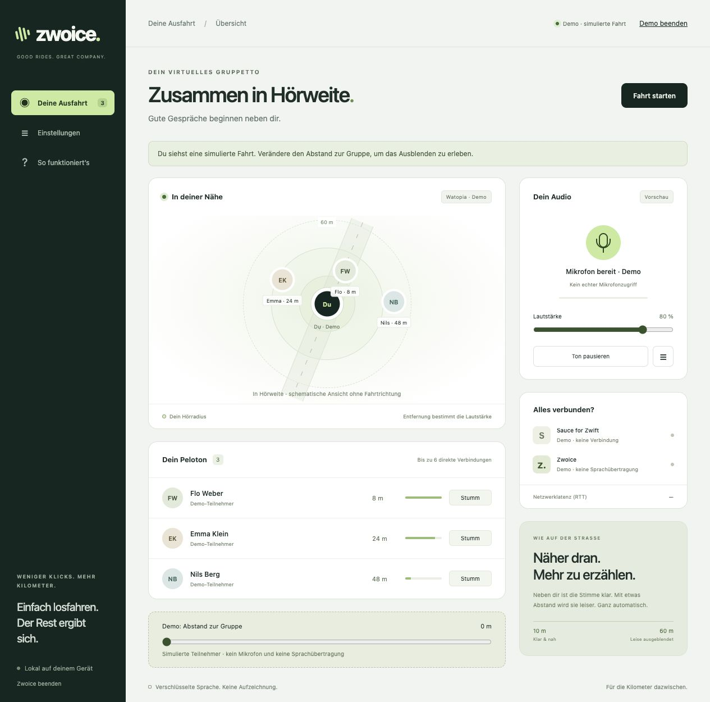

# Zwoice

**Zusammen in Hörweite.** Plattformübergreifender Proximity-Voice-Chat für Zwift, mit Positionsdaten aus Sauce for Zwift.

Zwoice besteht aus einem kleinen Go-Programm und einer Oberfläche im vorhandenen Browser. Es bündelt weder Chromium noch eine Node-Runtime. Der Browser übernimmt seine optimierte WebRTC-Audioverarbeitung. Der Go-Prozess verbindet die lokale Sauce-API mit dem Signalisierungsdienst auf Railway. Sprache läuft verschlüsselt direkt zwischen Fahrern, bei Bedarf über TURN.



## Benutzen

1. [Zwoice herunterladen](https://zwoice-production.up.railway.app/) und öffnen.
2. Zwift und Sauce for Zwift starten.
3. **Fahrt starten** anklicken und das Mikrofon erlauben.

Kein Zwoice-Konto, kein Einladungscode, keine Eingabe von IDs oder Serveradressen. Zwoice übernimmt deinen Fahrer und Anzeigenamen automatisch aus Sauce und wartet auf deine Fahrt. Der Startbildschirm zeigt direkt, wenn Sauce oder die eigene Fahrt noch fehlt. Technische Optionen sind unter „Erweitert“ verborgen.

Alle aktiven Zwoice-Nutzer in derselben Zwift-Welt, Event-Gruppe und Sportart können sich in räumlicher Nähe hören. Zwoice verlangt keine Zwift-Passwörter. Sauce und Zwift bleiben separate Anwendungen mit eigener Einrichtung. Die von Sauce gelieferte Identität ist keine kryptografisch verifizierte Zwift-Kontoinhaberschaft; siehe [Sicherheitsmodell](docs/SECURITY.md).

Die **Demo** ist eine ausdrücklich gekennzeichnete Vorschau. Sie benötigt weder Sauce noch Mikrofon und überträgt keine Sprache.

## Funktionen

- Eigene Position über das tatsächliche Sauce-Abonnement `athlete/self/v2`, nicht über den beobachteten Kamerafahrer.
- Dreidimensionale Distanz; volle Lautstärke bis 10 m, sanftes Ausblenden bis 60 m. Bestehende Verbindungen bleiben bis 75 m stumm bereit, um ständiges Neuverbinden zu vermeiden.
- Höchstens sechs Sprachpartner pro Fahrer, symmetrische Verbindungen und räumliche Indizierung auf dem Server.
- Opus mit 32 kbit/s Obergrenze pro Sender/Verbindung, DTX und FEC in der Aushandlung; Mono, Echounterdrückung, Geräuschunterdrückung und automatische Pegelregelung nach Browser-Unterstützung.
- Mikrofonwahl, Ausgabegerät nach Browser-Unterstützung, Gesamtlautstärke, Mikrofon stumm, einzelne Fahrer stumm, Audio pausieren und Push-to-talk bei Fensterfokus.
- Automatisches Wiederverbinden mit Backoff; Stummschalten bei veralteten Positionsdaten, Verbindungsverlust oder Geräteproblemen.
- Optionale TURN-only-Verbindungen zum Schutz der IP-Adresse gegenüber anderen Fahrern.
- Kurzlebige TURN-Zugangsdaten aus Cloudflare oder coturn, mit Erneuerung während langer Sitzungen.
- Keine Audioaufzeichnung, Analyse-Skripte, externen Schriftarten oder persistent gespeicherten Positionsverläufe.

## Lokal entwickeln

Go 1.26.3 oder neuer:

```sh
go run ./cmd/zwoice
```

Die Oberfläche liegt unter `http://127.0.0.1:8787`. Für einen zweiten lokalen Client: `go run ./cmd/zwoice -port 8788`. `-open=false` unterdrückt das automatische Browserfenster.

Lokaler Server in einem weiteren Terminal:

```sh
go run ./cmd/zwoice server
```

Für den lokalen Server unter Einstellungen → Erweitert `http://127.0.0.1:8080` verwenden. Entfernte Server verlangen HTTPS. Ohne konfiguriertes TURN können restriktive Netzwerke keine Sprache verbinden. Der öffentliche Betrieb benötigt keine Signierschlüssel oder vom Betreiber erzeugten Einladungen.

## Prüfen und Pakete bauen

```sh
go vet ./...
go test -race ./...
npm ci
npm test
npx playwright install chromium
npm run test:browser
node scripts/release.mjs 1.1.0
```

Node/Playwright werden ausschließlich für Entwicklung und Tests benötigt. Die Browser-Integrationstests starten zwei vollständige lokale Clients, einen echten Signalisierungsserver und eine kontrollierte Sauce-Quelle. Sie prüfen tatsächliche WebRTC-Audiopakete, Stummschaltung, Distanzänderung, Weltwechsel, veraltete Daten, Server-Neustart und Freigabe der Audiogeräte.

Die Paketierung erzeugt sechs portable Pakete und auf macOS eine universelle DMG. `scripts/windows-installer.ps1` baut unter Windows einen Installer, der AMD64/ARM64 automatisch auswählt; CI prüft Installation, Programmstart und Deinstallation. SHA-256-Prüfsummen begleiten die Veröffentlichung. macOS-Pakete enthalten eine `.app`; ohne Entwicklerzertifikat ist ihre lokale Signatur keine Apple-Notarisierung. Windows-Pakete sind ohne bereitgestelltes Zertifikat unsigniert.

## Betrieb und technische Entscheidungen

- [Installation und Bedienung](docs/INSTALL.md)
- [Railway und Cloudflare TURN](docs/DEPLOYMENT.md)
- [Architektur, Grenzen und Skalierung](docs/ARCHITECTURE.md)
- [Geprüfte Sauce-Schnittstelle](docs/SAUCE.md)
- [Daten und Sicherheitsmodell](docs/SECURITY.md)
- [Freigabeprüfungen und Messergebnisse](docs/VALIDATION.md)

Repository: [iamrobertduda/Zwoice](https://github.com/iamrobertduda/Zwoice). Zwoice ist ein unabhängiges Projekt und nicht mit Zwift oder Sauce LLC verbunden.
