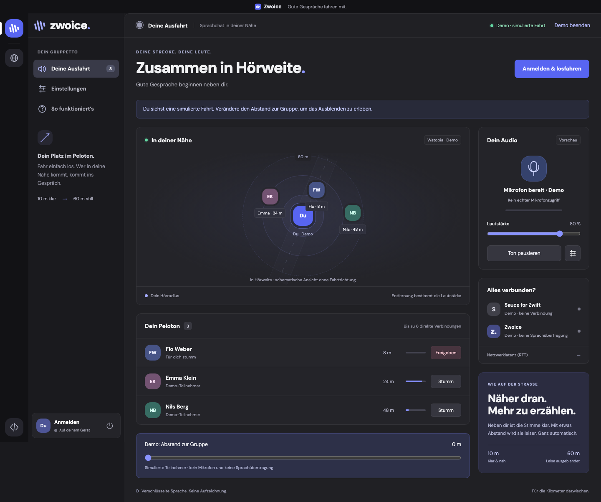

# Zwoice

**Entwicklungszweig für zentrale Beobachter – noch nicht veröffentlicht.** Umstellung und Freigabekriterien: [OBSERVERS.md](docs/OBSERVERS.md). Die verlinkte öffentliche Website liefert weiterhin die bisherige Version mit lokalem Sauce.

**Zusammen in Hörweite.** Plattformübergreifender Proximity-Voice-Chat für Zwift, mit Positionsdaten aus Sauce for Zwift.

Zwoice besteht aus einem kleinen Go-Programm und einer Oberfläche im vorhandenen Browser. Es bündelt weder Chromium noch eine Node-Runtime. Der Browser übernimmt seine optimierte WebRTC-Audioverarbeitung. Der Go-Prozess verbindet die Browseroberfläche mit Railway. Ein zentraler Betreiber-Worker liefert ausschließlich die Positionen bestätigter Fahrer. Sprache läuft verschlüsselt direkt zwischen Fahrern, bei Bedarf über TURN.



Die Oberfläche und die [Website](assets/zwoice-website.png) verwenden ein gemeinsames dunkles Design mit blauvioletten Akzenten. Schriften und Grafiken werden lokal ausgeliefert; es kommen keine zusätzlichen Laufzeitbibliotheken hinzu. Die Website gibt es auf Deutsch, Englisch, Französisch, Niederländisch, Italienisch, Spanisch, Dänisch, Norwegisch, Schwedisch, Polnisch und Portugiesisch (`/de/`, `/en/` …); `/` leitet nach Browsersprache weiter, sonst auf Englisch. Die Texte liegen in `internal/web/site/i18n/`, die App selbst ist weiterhin deutsch.

## Benutzen

1. [Zwoice herunterladen](https://zwoice-production.up.railway.app/) und öffnen.
2. Mit E-Mail und Anmeldecode dein Konto erstellen oder anmelden.
3. Den eigenen Zwift-Fahrer suchen und mit einem vorübergehenden Profilcode bestätigen.
4. Zwift starten, **Fahrt starten** anklicken und das Mikrofon erlauben.

Dieser Ablauf gehört zum neuen Entwicklungsstand. Die bestehenden Downloads enthalten ihn noch nicht.

Ein verifiziertes Zwoice-Konto ist für Sprachchat und TURN erforderlich. Keine Einladung und keine Eingabe von IDs oder Serveradressen. Auf Wunsch bleibt die Anmeldung auf dem Gerät 30 Tage gültig. Zwoice merkt sich die bestätigte Fahrer-Verknüpfung und wartet auf frische Daten von den zentralen Beobachtern. Technische Optionen sind unter „Erweitert“ verborgen.

[Anmeldung ansehen](assets/zwoice-login.png) · [Betreiberansicht ansehen](assets/zwoice-admin.png) (mit Testkonten).

Alle aktiven Zwoice-Nutzer in derselben Zwift-Welt, Event-Gruppe und Sportart können sich in räumlicher Nähe hören. Zwoice verlangt keine Zwift-Passwörter. Endnutzer installieren kein Sauce mehr. Die Profilbestätigung belegt Zugriff auf den Zwift-Namen zum Bestätigungszeitpunkt, ist aber kein offizieller Zwift-OAuth-Login; siehe [Sicherheitsmodell](docs/SECURITY.md).

Die **Demo** ist eine ausdrücklich gekennzeichnete Vorschau. Sie benötigt weder Sauce noch Mikrofon und überträgt keine Sprache.

## Funktionen

- Selbstregistrierung per verifiziertem E-Mail-Code; geschützte Sitzungen und Betreiberansicht für Kontosperren, Sprachzugang und Tageslimits.
- Fahrer-Verknüpfung und zentrale Position über das ID-gebundene Sauce-Abonnement `athlete/{id}/v2`; Benutzer können keine eigenen Positionen hochladen.
- Dreidimensionale Distanz; volle Lautstärke bis 10 m, sanftes Ausblenden bis 60 m. Bestehende Verbindungen bleiben bis 75 m stumm bereit, um ständiges Neuverbinden zu vermeiden.
- Höchstens sechs Sprachpartner pro Fahrer, symmetrische Verbindungen und räumliche Indizierung auf dem Server.
- Opus mit 32 kbit/s Obergrenze pro Sender/Verbindung, DTX und FEC in der Aushandlung; Mono, Echounterdrückung, Geräuschunterdrückung und automatische Pegelregelung nach Browser-Unterstützung.
- Mikrofonwahl, Ausgabegerät nach Browser-Unterstützung, Gesamtlautstärke, Mikrofon stumm, einzelne Fahrer stumm, Audio pausieren und Push-to-talk bei Fensterfokus.
- Automatisches Wiederverbinden mit Backoff; Stummschalten bei veralteten Positionsdaten, Verbindungsverlust oder Geräteproblemen.
- Optionale TURN-only-Verbindungen zum Schutz der IP-Adresse gegenüber anderen Fahrern.
- Kurzlebige TURN-Zugangsdaten aus Cloudflare oder coturn, mit Erneuerung während langer Sitzungen.
- Keine Audioaufzeichnung, Analyse-Skripte, extern geladenen Schriftarten oder persistent gespeicherten Positionsverläufe.

## Lokal entwickeln

Go 1.26.3 oder neuer:

```sh
go run ./cmd/zwoice
```

Die Oberfläche liegt unter `http://127.0.0.1:8787`. Für einen zweiten lokalen Client: `go run ./cmd/zwoice -port 8788`. `-open=false` unterdrückt das automatische Browserfenster.

Lokaler Server in einem weiteren Terminal:

```sh
ZWOICE_DATA_DIR=./data go run ./cmd/zwoice server
```

Für den lokalen Server unter Einstellungen → Erweitert `http://127.0.0.1:8080` verwenden. Entfernte Server verlangen HTTPS. Ohne konfiguriertes TURN können restriktive Netzwerke keine Sprache verbinden. Die Anmeldung benötigt einen Resend-Schlüssel und einen verifizierten Absender; siehe [Betrieb](docs/DEPLOYMENT.md). Ohne Mailkonfiguration bleibt der Zugang geschlossen. Für lokale Tests nutzt `go run ./tests/harness.go` ein simuliertes Postfach, das nicht Bestandteil der App ist.

## Prüfen und Pakete bauen

```sh
go vet ./...
go test -race ./...
npm ci
npm test
npx playwright install chromium
npm run test:browser
node scripts/release.mjs 1.3.0
```

Desktop-Nutzer benötigen weder Node noch Sauce. Node/Playwright dienen der Entwicklung; der zentrale Betreiber-Worker verwendet separat die offizielle Sauce-Laufzeit und Node für die isolierte Konfiguration. Die Browser-Integrationstests starten zwei vollständige lokale Clients, einen echten Signalisierungsserver und einen authentifizierten synthetischen Beobachter. Sie prüfen tatsächliche WebRTC-Audiopakete, Stummschaltung, Distanzänderung, Weltwechsel, veraltete Daten, Server-Neustart und Freigabe der Audiogeräte.

Die Paketierung erzeugt sechs portable Pakete und auf macOS eine universelle DMG. `scripts/windows-installer.ps1` baut unter Windows einen Installer, der AMD64/ARM64 automatisch auswählt; CI prüft Installation, Programmstart und Deinstallation. SHA-256-Prüfsummen begleiten die Veröffentlichung. macOS-Pakete enthalten eine `.app`; ohne Entwicklerzertifikat ist ihre lokale Signatur keine Apple-Notarisierung. Windows-Pakete sind ohne bereitgestelltes Zertifikat unsigniert.

## Betrieb und technische Entscheidungen

- [Installation und Bedienung](docs/INSTALL.md)
- [Zentrale Beobachter, öffentliche Bedingungen und Kapazitätsprüfung](docs/OBSERVERS.md)
- [Railway und Cloudflare TURN](docs/DEPLOYMENT.md)
- [Architektur, Grenzen und Skalierung](docs/ARCHITECTURE.md)
- [Geprüfte Sauce-Schnittstelle](docs/SAUCE.md)
- [Daten und Sicherheitsmodell](docs/SECURITY.md)
- [Freigabeprüfungen und Messergebnisse](docs/VALIDATION.md)

Repository: [iamrobertduda/Zwoice](https://github.com/iamrobertduda/Zwoice). Zwoice ist ein unabhängiges Projekt und nicht mit Zwift oder Sauce LLC verbunden.
